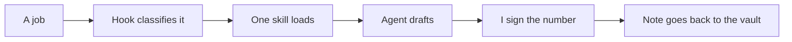

# AI work OS

Public pattern of how I use Cursor day to day. Syed Shoaib Roshan H.

The private system routes real client work. This repository is the same shape with the client playbooks, inventories and data removed. Nothing here is a customer file.

Live walkthrough of the same router: [syedshoaibroshan.com](https://www.syedshoaibroshan.com)

## Tools

| Tool | What I use it for |
|---|---|
| Cursor | Where the work happens. Skills, agents and hooks live in this repo's `.cursor/` folder. |
| Claude | The model inside Cursor for the first draft, the factor shortlist and the gap list. |
| Obsidian | Where a signed decision goes, so the next cycle opens last time's note. |
| Replit | A rough screen, when I want to see a flow before it is worth a real build. |

## Three workflows

1. **[Work router](workflows/01-work-router.md).** One job loads one skill. A hook blocks the folders where client files live. I stopped re-explaining a method I had already written down.
2. **[Inventory and disclosure](workflows/02-inventory-and-disclosure.md).** Purchased-goods lines mapped to an emission factor, and a GRI or BRSR section drafted from a checked model. I still choose the factor and sign the number. An inventory that took about two weeks now takes a few days. A report that took weeks is an edit.
3. **[The site](workflows/03-portfolio-site.md).** [syedshoaibroshan.com](https://www.syedshoaibroshan.com), built in Cursor and shipped on a Cloudflare Worker. The page "An AI-native operating system" is this router, drawn so it can be followed without the private files.

## How a job runs

Drop `.cursor/` into a Cursor project and the three skills are usable: `emissions-method`, `disclosure-draft`, `rfp-matrix`. Ask for one of those jobs. The hook in `.cursor/hooks.json` refuses `clients/`, `local/` and env files.

The call stays with the person. The sheet, the first draft and the blank page do not.
